# Coffee Pub Showrunner

**Audience:** anyone deciding whether to install Coffee Pub Showrunner, or looking for where to read
more about it.

The production side of the Coffee Pub suite: a standalone macOS and Windows app that wraps any
web page in a fixed-size Chromium window so OBS can capture it as its own source, and keeps that
OBS source cropped, pointed and in sync. It's optimized for running FoundryVTT sessions but not
exclusive to Foundry -- it works with any web-based experience. It signs in to Coffee Pub Chameleon
to publish each player at the table as their own OBS source, and it runs a small local HTTPS
server so a Foundry module -- Coffee Pub Herald first -- can trigger an OBS action (switch scene,
show or hide a source, start or stop recording or streaming) when something happens in the game.
Each kind of recording you do (D&D, a livestream, a podcast) gets its own **profile** with its own windows,
session fields and rules, and Showrunner can level everyone's microphone volume to one target.
The product page is at [coffeepubstudio.com/products/showrunner](https://coffeepubstudio.com/products/showrunner),
and what changed in each release is in the [changelog](https://github.com/Drowbe/coffee-pub-showrunner/blob/main/CHANGELOG.md).

OBS window-capture source management on Windows has been run on real Windows hardware on an earlier
release and is being re-checked; see [Known issues](known-issues.md).

- [Getting started](userguides/userguide-getting-started.md) -- the first five minutes.
- [Settings, windows and the edge dock](userguides/userguide-settings.md) -- the left rail, profiles and
  backups, adding windows, the edge dock, keyboard shortcuts, Retina displays.
- [Windows and regions as OBS sources](userguides/userguide-obs.md) -- connecting to OBS, the
  whole-window source, and cropping part of a window into its own source.
- [Coffee Pub Chameleon in OBS](userguides/userguide-chameleon.md) -- publishing the party as OBS
  sources, audio filters, Calibrate and Auto level.
- [Teleprompter](userguides/userguide-teleprompter.md) -- a presenter-only window that shows a Markdown script and
  fires Automations events from its cues.
- [Configuration file reference](userguides/userguide-configuration.md) -- the config.json
  shape, field by field.
- [Automations API](api/api-automations.md) -- let a Foundry module drive OBS through Showrunner.
- [Automations architecture](architecture/architecture-automations.md) -- how the Automations
  feature is built and why.
- [Profiles, backups and audio leveling architecture](architecture/architecture-profiles-and-audio.md) -- how
  profiles are stored and switched, how backups work, and how leveling measures and adjusts volume.
- [Design tokens](designsystem/design-tokens.md) and [Design components](designsystem/design-components.md)
  -- the control panel's own colors, layout tokens, and reusable UI patterns.

## Screenshots

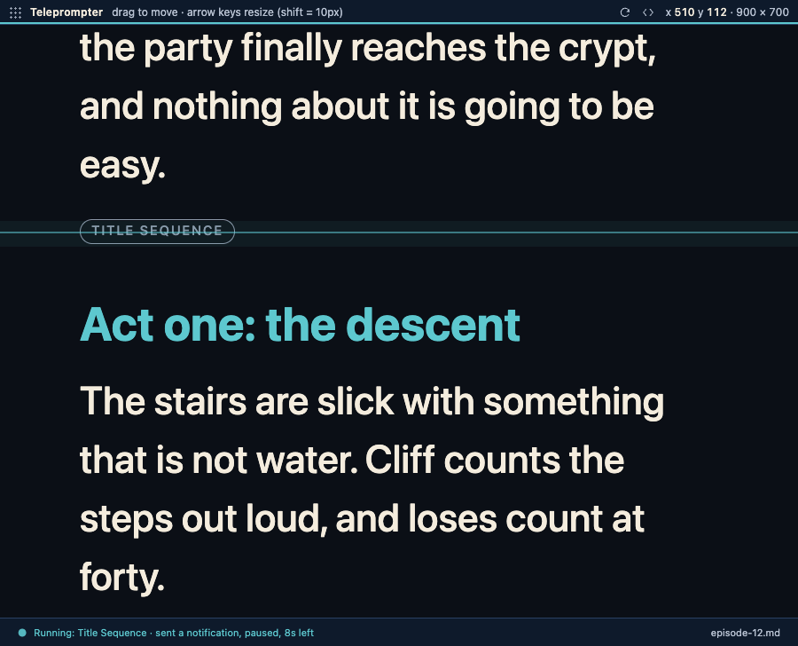

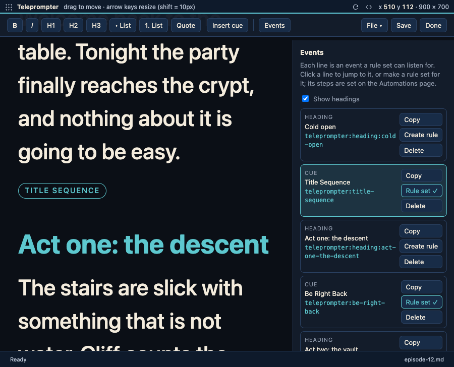

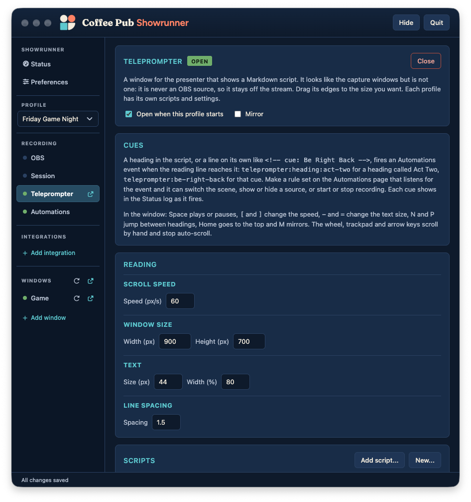

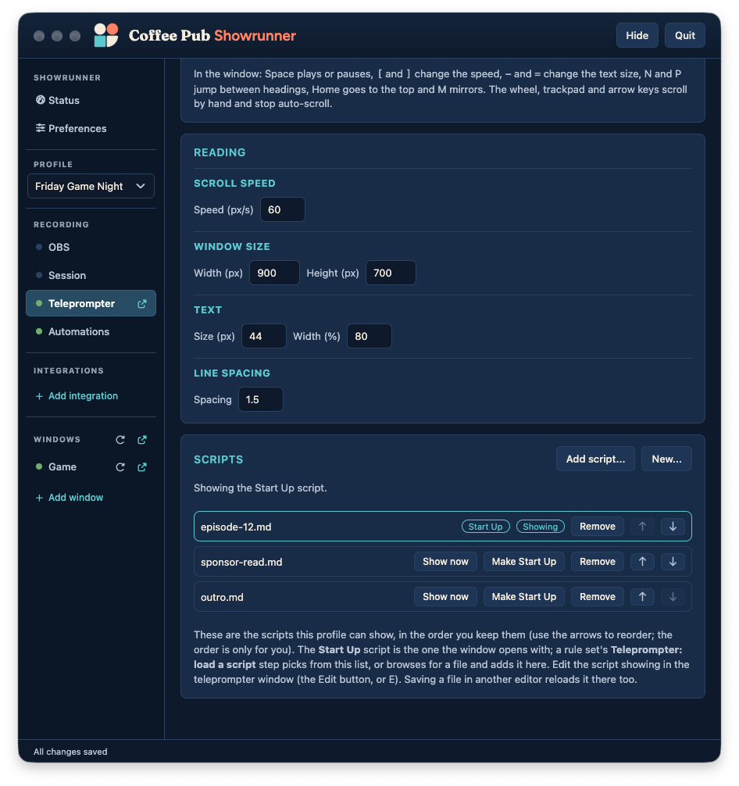

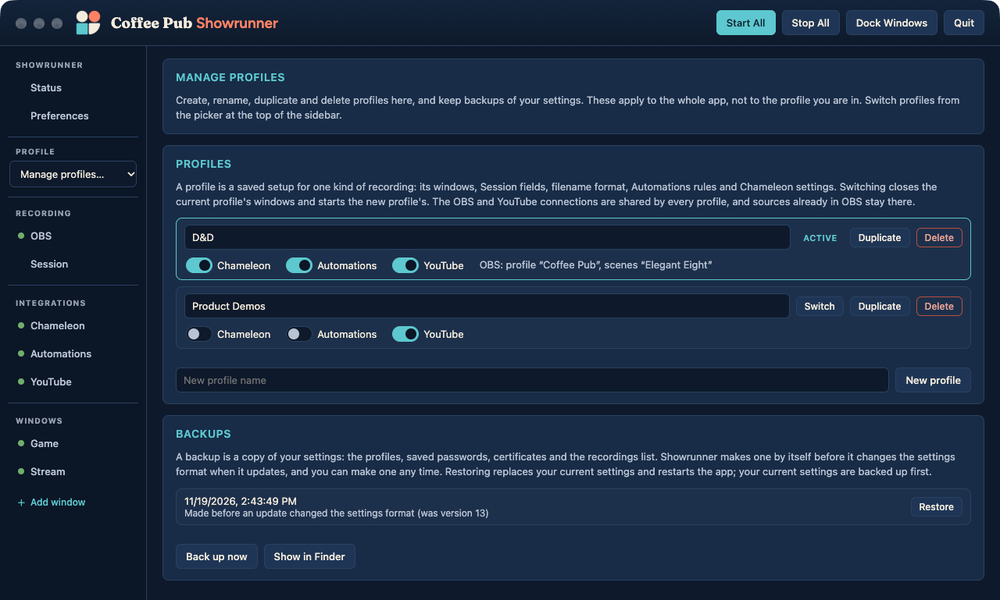

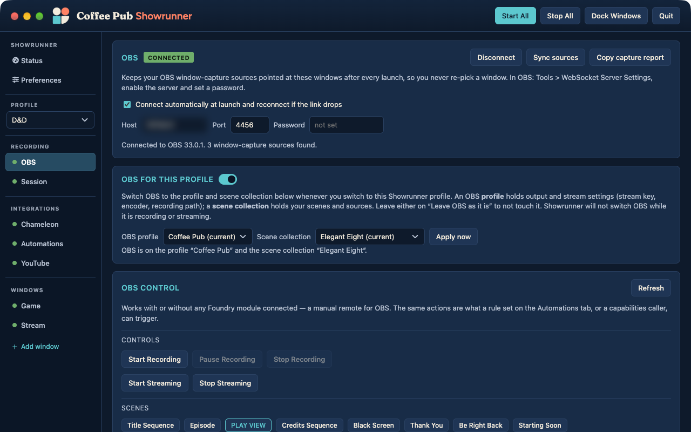

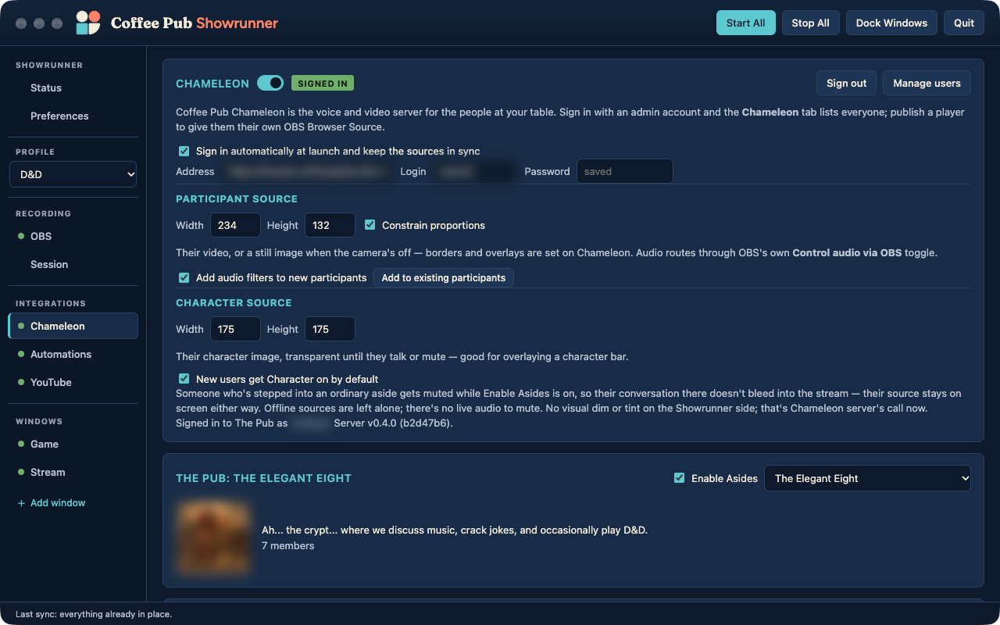

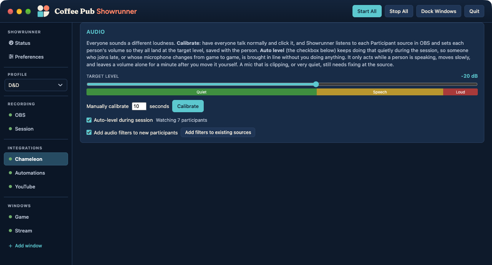

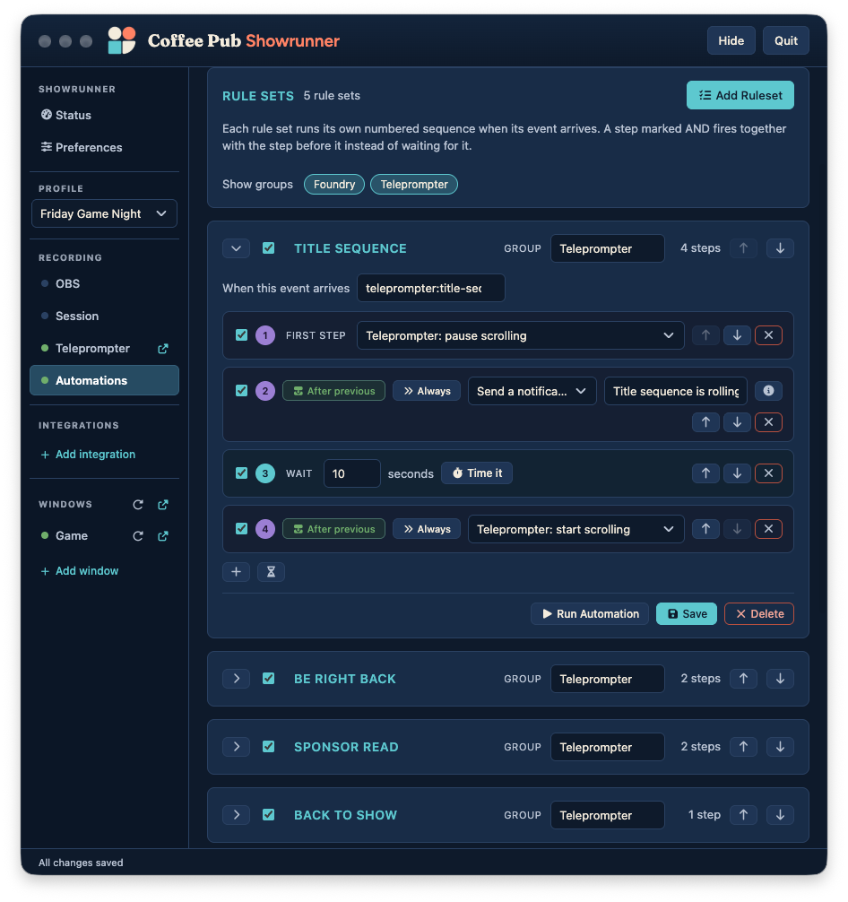

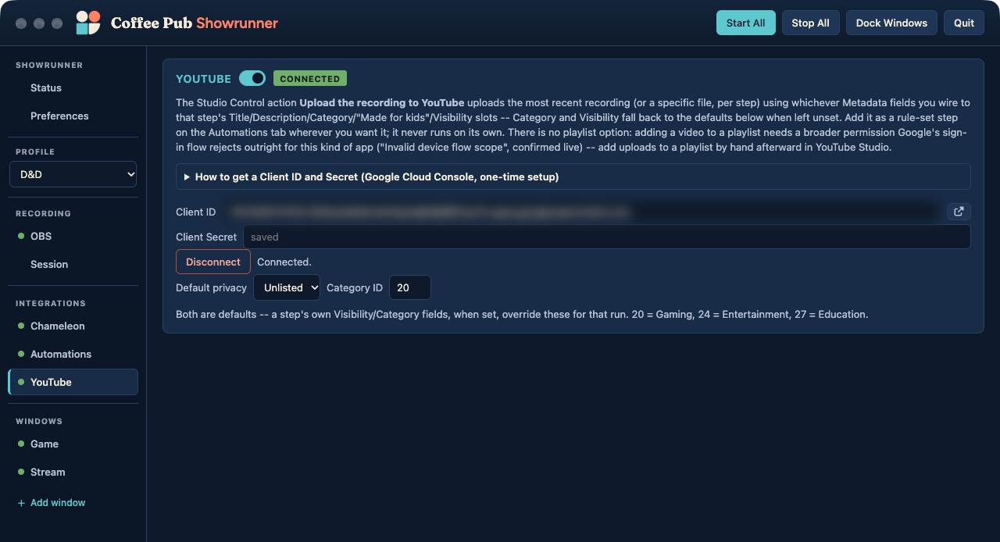

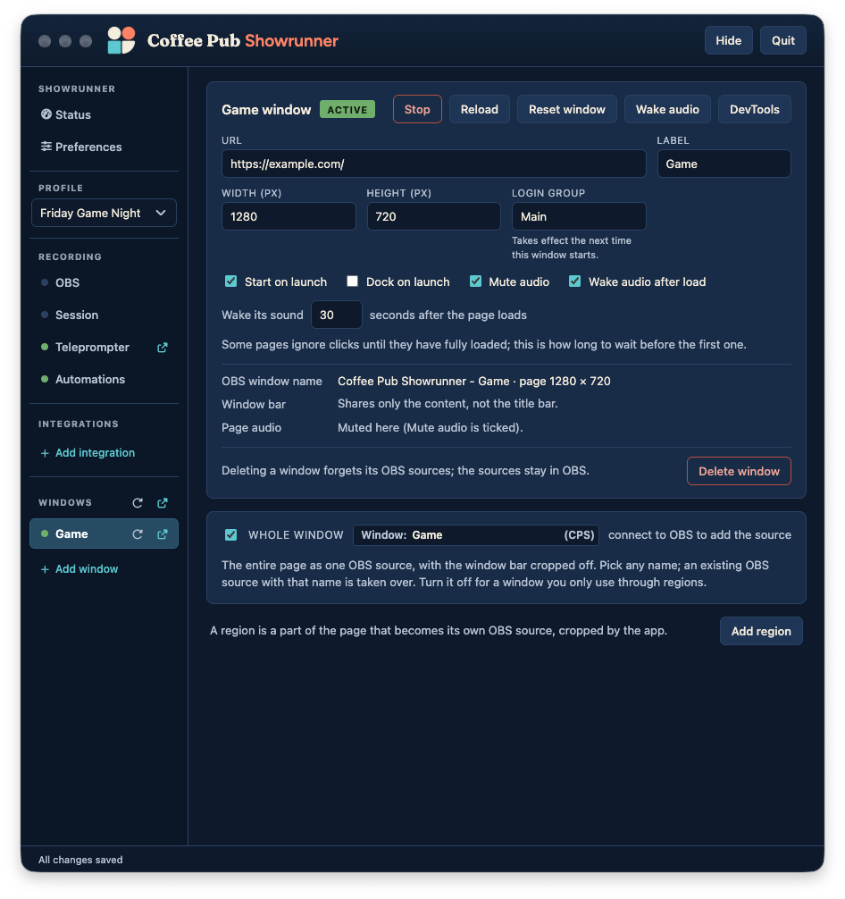

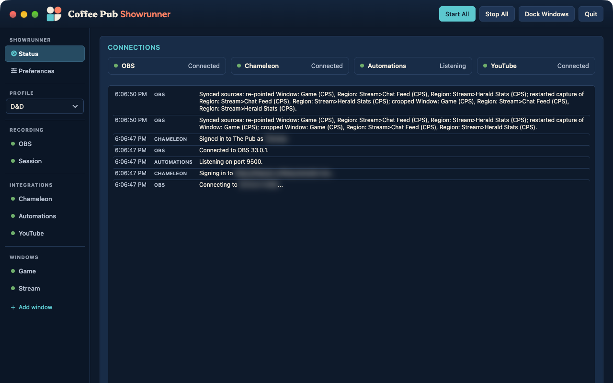

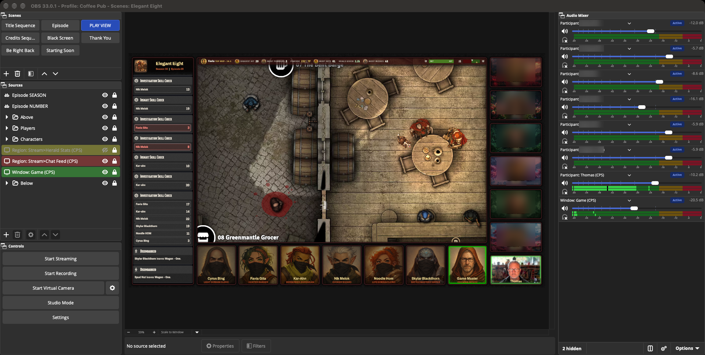

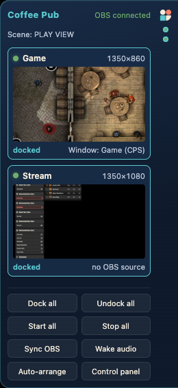

See the [repository README](https://github.com/Drowbe/coffee-pub-showrunner) for requirements and
how to get the app.
